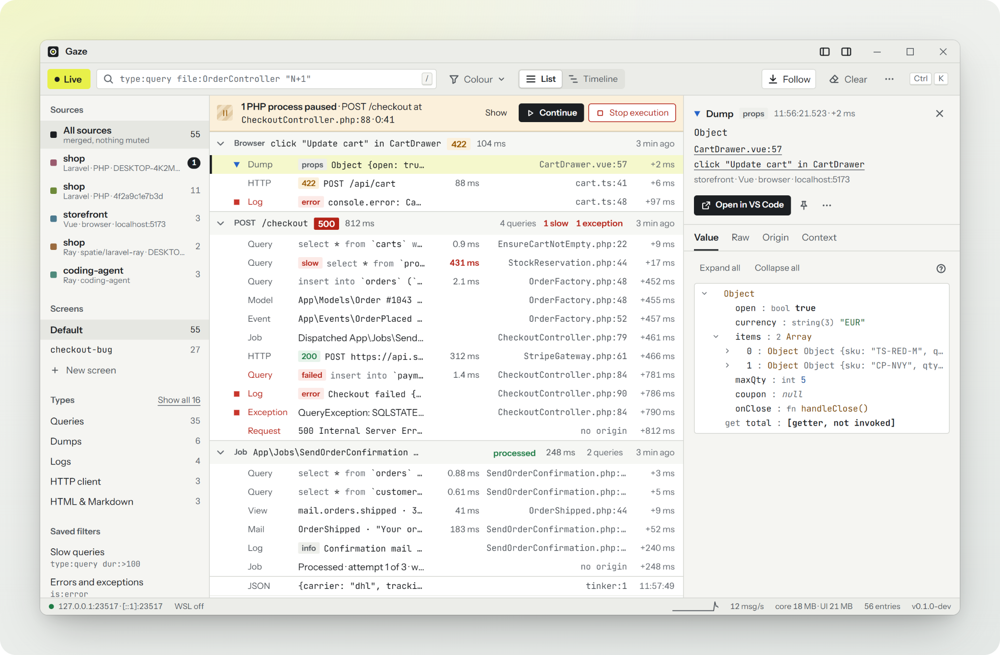

# @thewonderjoy/gaze-js

Send values from JavaScript to the Gaze desktop app. Works in Node, Bun, Deno, browsers, workers and edge runtimes. Each value shows up with the file and line it came from.

Gaze is a fast debug window for PHP, Laravel and JavaScript (Windows first). It also accepts Spatie Ray's format, and this client can speak it too (`wire: 'ray'`), so it works with the Ray app and Buggregator as well.



Node 20.19+ (22.12+ recommended). No runtime dependencies.

```bash
npm install -D @thewonderjoy/gaze-js
```

## Use

```js
import { ray } from '@thewonderjoy/gaze-js'; // `gaze` and `dump` are the same function

ray('order', order).blue().label('checkout');
ray().table(rows, 'Rows');
ray().exception(err);
await ray().pause(); // waits until you press Continue in the app
```

`require('@thewonderjoy/gaze-js')` works too.

Values are copied when you call `ray()`, so changing the object afterwards does not change what you logged. Short scripts don't need anything extra: pending sends finish before Node exits. Call `await ray.flush()` before `process.exit()`, and `ctx.waitUntil(ray.flush())` in edge handlers.

## What you can call

- **Content:** `ray(...values)`, `send`, `pass(v)` (sends and returns `v`), `text`, `html`, `markdown`, `mermaid`, `json`, `toJson`, `xml`, `table`, `image`, `date`, `className`, `separator`, `entry(kind, body)`
- **Look:** `green` `orange` `red` `purple` `blue` `gray`, `small` / `large`, `label`, `hide`, `expand`, `expandAll`, `remove`
- **App:** `newScreen`, `clearScreen`, `clearAll`, `screenColor`, `showApp`, `hideApp`, `notify`, `confetti`, `project`
- **Control:** `if`, `showIf` / `showWhen`, `removeIf` / `removeWhen`, `once`, `limit`, `count`, `rateLimiter()`, `macro`, `enable` / `disable`
- **Debugging:** `trace`, `caller`, `exception(err)`, `measure(name | fn)`, `stopTime`, `pause()`, `die()`

JS-only extras:

```js
ray.at('cart').send(cart);              // fixed id: later calls update the same entry
const stop = ray.watch(() => store.total, { interval: 500 }); // re-send when it changes
ray.group('checkout', () => { /* these entries are grouped together */ });
await ray.capture({ console: true, errors: true, network: true }); // forward console, errors and fetch
ray.configure({ port: 23518, project: 'shop' });
```

## Imports

| Import | What |
|---|---|
| `@thewonderjoy/gaze-js` | `ray`, `gaze`, `dump`. Picks the Node, browser or edge build by itself. |
| `@thewonderjoy/gaze-js/auto` | Import once to forward console output, errors and network calls. |
| `@thewonderjoy/gaze-js/vite` | Vite plugin (below). |
| `@thewonderjoy/gaze-js/noop` | Same API, does nothing. For production builds. |
| `@thewonderjoy/gaze-js/vue` | `RayPlugin`, `useRay()` |
| `@thewonderjoy/gaze-js/react` | `useRay()`, `<RayBoundary>`, `rayRootOptions()` |
| `@thewonderjoy/gaze-js/svelte` | `rayInspect`, `rayInspector()`, `rayBoundary()` |
| `@thewonderjoy/gaze-js/global` | A script tag build that sets `window.ray` |

## Settings

`ray.configure(options)`:

| Option | Default | |
|---|---|---|
| `host`, `port` | `localhost`, `23517` | Node also reads `GAZE_HOST` / `GAZE_PORT`, then `RAY_HOST` / `RAY_PORT` |
| `wire` | `native` | `native` (Gaze), `ray` (Spatie Ray format) or `auto` |
| `enabled` | `true` | In Node, off when `NODE_ENV=production` unless `GAZE_ENABLED=true` |
| `project` | | a name, or `{ name, root }` |
| `url` | | send to a relay instead, for example `https://app.test/_gaze` |

If the app is closed, entries wait in a small queue and are sent when it comes back. Nothing ever throws into your code.

## Vite plugin

```js
// vite.config.js
import gaze from '@thewonderjoy/gaze-js/vite';

export default { plugins: [gaze({ project: 'shop' })] };
```

In `vite dev` it adds the client to your pages (Laravel Blade pages too), sends browser entries through Vite's own connection (no CORS, works from a phone on your network), and forwards Vite compile errors to the app. In `vite build` it swaps the client for the no-op version, so production bundles send nothing.

## Framework adapters

```js
// Vue 3
import { RayPlugin } from '@thewonderjoy/gaze-js/vue';
app.use(RayPlugin);                      // Vue errors and warnings go to Gaze

// React 19
import { useRay, rayRootOptions } from '@thewonderjoy/gaze-js/react';
createRoot(el, rayRootOptions());        // React errors with the component stack
useRay(cart, { label: 'cart' });         // one entry, updated when `cart` changes

// Svelte 5
import { rayInspector } from '@thewonderjoy/gaze-js/svelte';
$inspect(cart).with(rayInspector('cart'));
```

## Without a bundler

```html
<script src="/vendor/gaze/gaze.global.js" data-port="23517"></script>
<script>ray('hello from a Blade page')</script>
```

## Develop

This package lives in the [thewonderjoy/gaze](https://github.com/thewonderjoy/gaze) monorepo under `packages/js`. The `thewonderjoy/gaze-js` repo is a read-only copy; send changes to the monorepo. From the monorepo root:

```bash
pnpm install
pnpm --filter @thewonderjoy/gaze-js build    # dist/
pnpm --filter @thewonderjoy/gaze-js check    # type check
pnpm --filter @thewonderjoy/gaze-js test     # unit tests, then end-to-end against the real server
pnpm --filter @thewonderjoy/gaze-js size     # bundle sizes
```

The end-to-end tests build and start the Gaze server, so they need Rust. `test:unit` skips them. How the client works inside: [INTERNALS.md](INTERNALS.md).

## Release

1. Set the new `version` in `packages/js/package.json` and commit.
2. Tag and push from the monorepo:

```bash
git tag js/v0.2.0
git push origin js/v0.2.0
```

CI tests, builds and publishes to npm, then copies `packages/js` to the `gaze-js` repo with tag `v0.2.0`. It stops if the tag and `package.json` disagree. Full steps, including the first publish: `RELEASING.md` in the monorepo.

## License

MIT
